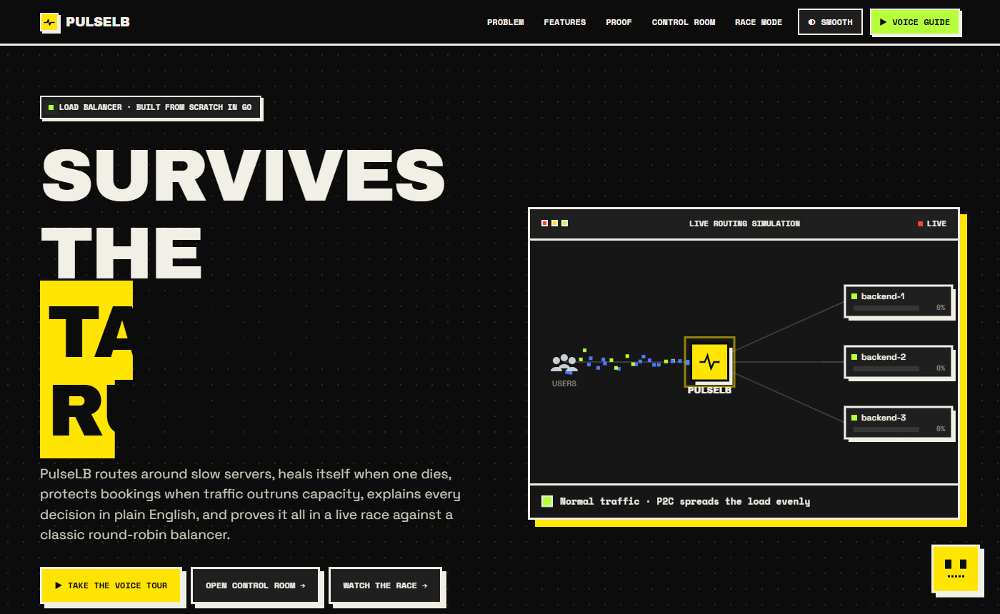
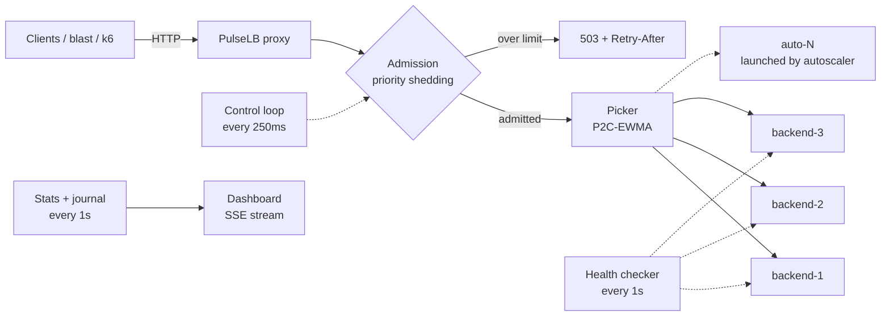
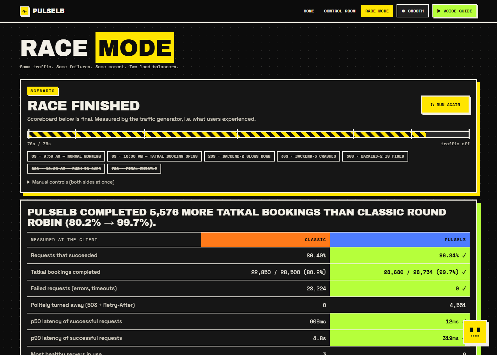
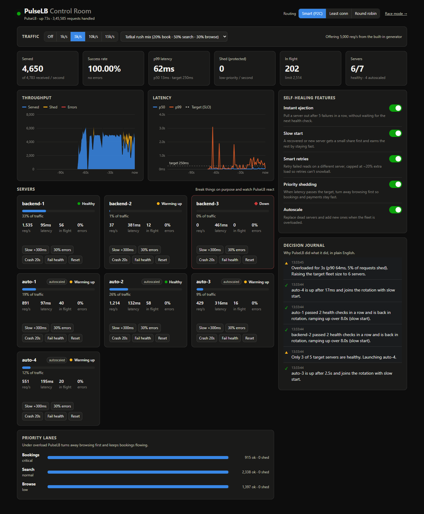

# PulseLB

**A load balancer written from scratch in Go that keeps a site alive during a "Tatkal 10 AM rush".**
It routes around slow servers, heals itself when one dies, protects bookings when there's more traffic than capacity,
explains every decision in plain English, and proves all of it in a live race against a classic round-robin balancer.



🎬 **Demo video (4:26):** [demo-video/pulselb-demo.mp4](demo-video/pulselb-demo.mp4): the landing page, the Control room breaking and healing servers live, and a full Race Mode run against round robin.

📸 **Screenshots:** [docs/shots/](docs/shots/), covering the loading screen, landing page, Control room, decision journal and a full race (retake them with `python scripts/shots.py` while the demo runs).

## Results at a glance

**The 10,000 requests/second target**, measured with two independent tools on one laptop
(Intel Core 5 210H, 12 threads, Windows 11 Home). The load generator, PulseLB and 3 backends all ran as separate processes on that same machine:

| Tool | Requests | Throughput | Success | p50 | p99 |
|---|---|---|---|---|---|
| `blast` (ours), 60 s | 575,009 | **9,997 req/s** steady state | 99.97% | 5.8 ms | 18.9 ms |
| `k6` (Grafana), 60 s | 599,637 | **9,993 req/s** | **100.00%** (0 failed) | 5.5 ms | 8.7 ms |

**Race Mode: same traffic, same failures, two balancers.** 3 runs of the scripted Tatkal Rush, measured at the client:

| | Classic round robin | PulseLB |
|---|---|---|
| Requests that succeeded | 77.6–77.7% | **97.6%** |
| Tatkal bookings completed | 77.5–77.8% | **99.7–99.8%** |
| Failed requests (errors and timeouts) | ~32,200 | **0** |
| p50 latency | 606 ms | **12 ms** |
| p99 latency | 4.8 s | **258–270 ms** |
| Turned away politely (503 + `Retry-After`) | 0 | ~3,450 (browse traffic only) |

Full numbers, methodology and caveats: [docs/RESULTS.md](docs/RESULTS.md). Raw JSON: [results/](results/).

## What makes it different

Most load balancer projects show "requests got split three ways". PulseLB is built around what happens when things go wrong.

| | A typical round-robin balancer | PulseLB |
|---|---|---|
| Choosing a server | Takes turns | **P2C-EWMA**: compares two servers' live latency and queue depth, picks the faster one |
| A server gets slow but still passes health checks | Keeps sending it a third of the traffic | Traffic to it drops to ~1% within a second; probes it so it can earn traffic back |
| A server crashes | Errors until the next health checks fail (seconds) | Ejected after 5 failures in a row (milliseconds); failed reads retried on another server |
| More traffic than capacity | Everyone slows down, queues explode, timeouts | Turns away **browsing** first so **bookings and payments** stay fast |
| Not enough servers | Nothing | Launches a replacement or an extra server, then retires it when the rush ends |
| Why did it do that? | Logs, if any | A **decision journal**: *"Sending only 11% of traffic to backend-2 instead of ~33%: it answers in 313ms vs 16ms for the others (19× slower)."* |
| Proof | A load-test screenshot | A live head-to-head race with a scoreboard |

## Quick start

Needs Go 1.22 or newer. No other dependencies: the standard library only, including the dashboard's charts.

```sh
go build -o bin/ ./cmd/...
```

**0. The whole show in one command** (landing page, voice guide, control room and Race Mode):

```sh
bin/demo
```

It opens http://127.0.0.1:9000 in your browser. Press **Take the voice tour** and Pulse, the built-in guide, explains each page out loud and drives the demo itself.
Presenter's script: [docs/DEMO.md](docs/DEMO.md).

**1. Control room on its own** (3 simulated backends in one process, autoscaling on):

```sh
bin/pulselb -demo
```

Open http://127.0.0.1:9090. Press **10k/s**, then break servers with the **Slow / 30% errors / Crash** buttons and watch the journal.

**2. Race Mode:**

```sh
bin/arena               # open http://127.0.0.1:9000 and press "Run the Tatkal Rush"
bin/arena -race         # or headless: prints the scoreboard, -json file.json to save it
```

**3. The 10k benchmark** (three terminals, so each piece is its own process):

```sh
bin/backend -ports 8001,8002,8003 -latency 5ms
bin/pulselb -backends http://127.0.0.1:8001,http://127.0.0.1:8002,http://127.0.0.1:8003
bin/blast -rate 10000 -duration 60s -json results/my-run.json
k6 run scripts/k6-10k.js          # optional independent cross-check
```

On Windows, the binaries are `bin\pulselb.exe` and so on.

## How it works



What happens to each request:

1. **Classify.** The path decides the priority: `/book` and `/pay` are *critical*, `/browse` and `/search` are *low*, everything else is *normal*.
   A client-supplied `X-Priority` header is ignored by default, because anyone could claim to be critical.
2. **Admit or shed.** If the number of requests in flight is over the class's share of the adaptive limit, answer `503` with `Retry-After: 1` straight away.
3. **Pick a backend** with the active algorithm (P2C-EWMA by default; round robin and least-connections are available and can be switched live).
4. **Forward.** Hop-by-hop headers are stripped, `X-Forwarded-For/Host/Proto` set, and the response is streamed back with an `X-Pulse-Backend` header.
   Upstream connections are pooled and capped at 512 per backend.
5. **Learn.** The response time updates the backend's latency average; failures count towards ejection.
6. **Retry** idempotent requests (GET/HEAD/OPTIONS with no body) on a *different* backend, within a retry budget.

### P2C-EWMA: the routing algorithm

For every request, PulseLB picks **two** random healthy backends and sends the request to the one with the lower cost:

```
cost = latency average × (requests in flight + 1)
```

The latency average is a "peak EWMA" (the approach used by Linkerd and Twitter's Finagle). A slower response is adopted immediately,
and faster ones pull the average down over about 1.5 s. Comparing just two servers, rather than always picking the single best, stops thousands of
concurrent requests from stampeding onto whichever server looked fastest a moment ago. A server that hasn't answered anything for 500 ms
gets one probe request, so a recovered server can prove it's fast again.

In the tests, a backend with 40 ms of added latency receives **1.6%** of traffic under P2C-EWMA; round robin would give it 33%.

### Self-healing features

Each one can be switched on and off live from the dashboard, which makes for a good demo ("now watch what happens without it").

| Feature | What it does | Why |
|---|---|---|
| **Instant ejection** | 5 failures in a row eject the server for 5 s, then 10 s, then 20 s at most. Never ejects more than half the fleet. | Health checks take seconds to notice; real traffic notices in milliseconds. The cap stops a bad deploy from ejecting everything. |
| **Slow start** | A new or recovered server ramps from 10% to a full share over 8 s. | A cold server flooded with full traffic often falls over again straight away. |
| **Smart retries** | Failed reads are retried on another server. A budget limits retries to ~20% of traffic, with a floor of ~10/s. | Retries without a budget turn one sick server into a retry storm that takes down the healthy ones. |
| **Priority shedding** | When p90 latency passes the target (250 ms), the concurrency limit drops below the current peak. Browsing is refused above 50% of the limit, search above 80%, bookings only at 100%. The limit grows back once latency is healthy. | When there's more traffic than capacity, someone waits. It should be the person browsing offers, not the person paying for a ticket. |
| **Autoscale** | Keeps a target number of healthy servers: replaces dead ones, raises the target after 3 s of overload, and drains extra ones when traffic falls. | The Tatkal rush lasts minutes; the fleet shouldn't be sized for it all day. |

Plus **active health checks** (every 1 s; 2 fails to mark down, 2 passes to come back), which is all the classic balancer gets.

### Race Mode

`cmd/arena` builds two identical worlds, each with 3 backends of 1,000 req/s capacity. It drives the same traffic at both
and injects the same failure into both at the same moment:

| Time | Event |
|---|---|
| 0 s | 9:59 AM, 750 req/s per side |
| 8 s | **10:00 AM, Tatkal opens**: 2,250 req/s per side (75% of capacity) |
| 20 s | **backend-2 slows down** by +400 ms but keeps passing health checks (a "gray failure") |
| 36 s | **backend-3 crashes**, restarting by itself 15 s later |
| 56 s | backend-2 is repaired |
| 66 s | the rush ends |

The scoreboard is measured by the traffic generator, so it's what users would have experienced, not what either balancer reports about itself.



### The control room



## Measuring honestly

- **Open-model load.** `blast` and the k6 script send at a fixed arrival rate whether or not earlier requests have finished.
  Most tools wait for each reply before sending the next, which quietly sends *less* traffic when the system slows down.
  If the generator can't keep up, it reports the shortfall as `dropped` instead of hiding it.
- **Everything on one laptop.** On this machine the ceiling is about **14k req/s**. At 20k, Windows itself runs out of socket buffers,
  because the generator, the balancer and the backends share 12 threads. That's a limit of the test setup, not of the code, but it's the number we measured.
- **Windows-specific limits we hit**, and what we did about each:
  - **Listen backlog of ~200** on Windows client editions: a burst of new connections gets "connection refused". `blast` opens its connections in batches before the test starts.
    The remaining 0.03% failures in the blast run are these.
  - **EcoQoS power throttling** parks background processes on efficiency cores. Every binary opts out via `SetProcessInformation`.
- **Race Mode runs at 2,250 req/s per side, not 10k.** Two complete stacks plus the generator share the laptop. Race Mode measures behaviour under failure; the 10k benchmark measures raw throughput.
- **Simulated backends.** They have a fixed number of worker slots, a service time, and a 1 s request-queue timeout (503 when overloaded), so they slow down under load the way real servers do.
- **What PulseLB isn't (yet):** no TLS, HTTP/1.1 only (no HTTP/2 or WebSockets), configured with flags, and a single balancer instance with no failover of its own.

## Bugs testing found, and the fixes

Building the race and the benchmarks broke PulseLB several times. Each fix is in the git history.

1. **Connection storm crash.** When one backend slowed and another crashed, every queued request opened a new socket. About 10k goroutines got stuck creating sockets and the process hit Go's 10,000-thread limit.
   *Fix:* cap upstream connections per backend, so excess requests wait for a pooled connection.
2. **No retries right after startup.** The retry budget started empty. *Fix:* a floor of ~10 retries/s, as Linkerd does.
3. **An unfair race.** The classic side's timeouts churned sockets until the shared machine ran out of ports, and that inflated PulseLB's error count too.
   *Fix:* realistic backend queue timeouts, and running the race at a scale one laptop handles cleanly.
4. **Latency stalls with idle CPU.** Caused by Windows EcoQoS. *Fix:* opt out of power throttling.
5. **A benchmark that lied.** The laptop went to sleep mid-run, the generator's clock jumped 74 minutes, and it reported a 4,417-second request. We threw the run away and re-ran it.

## Security notes

- Backend control endpoints (`/__pulse/...`) are blocked at the balancer, so clients can't crash servers through it.
- The admin API listens on `127.0.0.1` by default. Every change needs an `X-Pulse-Admin: 1` header, which a malicious web page can't send cross-origin without a CORS preflight, and the API never approves one.
- Chaos commands only go to registered backends. There's no "fetch any URL" endpoint.
- `X-Priority` from clients is ignored unless `TrustHeader` is enabled behind a trusted edge.

## Project layout

```
cmd/pulselb      the load balancer + control-room dashboard
cmd/backend      simulated application servers with chaos controls
cmd/blast        open-model load generator
cmd/arena        Race Mode: classic vs PulseLB
cmd/demo         everything in one process: landing page, voice guide, control room, Race Mode
internal/arena   the Race Mode engine (two worlds, scripted Tatkal Rush, scoring)
internal/lb      proxy, pickers, health, ejection, admission, autoscaler, journal, admin API
internal/hist    lock-free latency histogram
internal/loadgen traffic generation and live traffic control
internal/backendsim  the simulated server
internal/perf    opts out of OS power throttling
internal/web     landing page, dashboard, arena and the Pulse voice guide (embedded; no JS libraries)
scripts/k6-10k.js    independent k6 cross-check
results/         raw JSON from the runs quoted above
```

## Tests

```sh
go test ./...
```

They cover round-robin distribution, P2C starving a slow backend, retries moving to another backend, no retries for POST, ejection and its 50% cap,
header handling, blocked control paths, admission priorities and the adaptive limit, the classifier, the retry budget, the admin header guard,
large-body streaming and the histogram.
